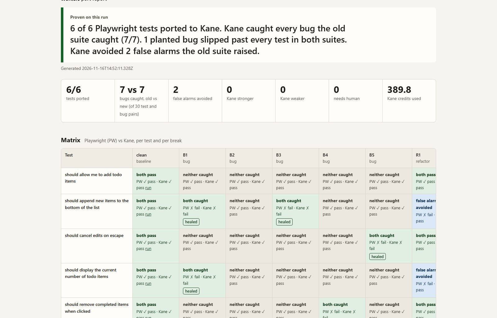
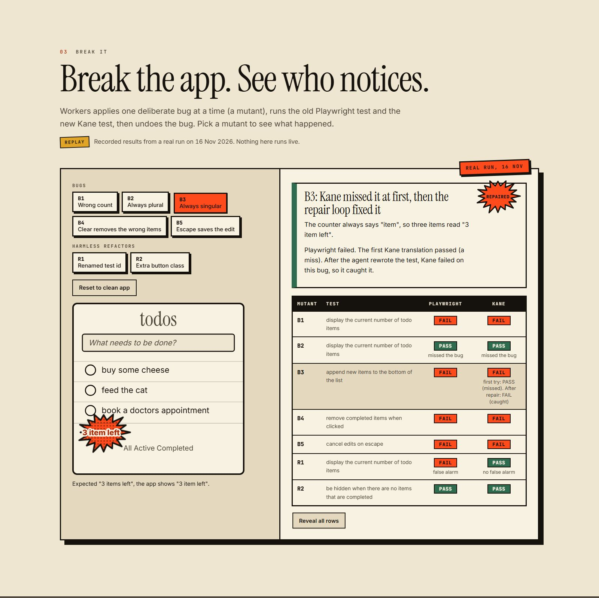
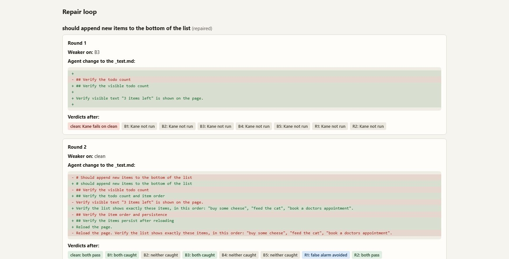
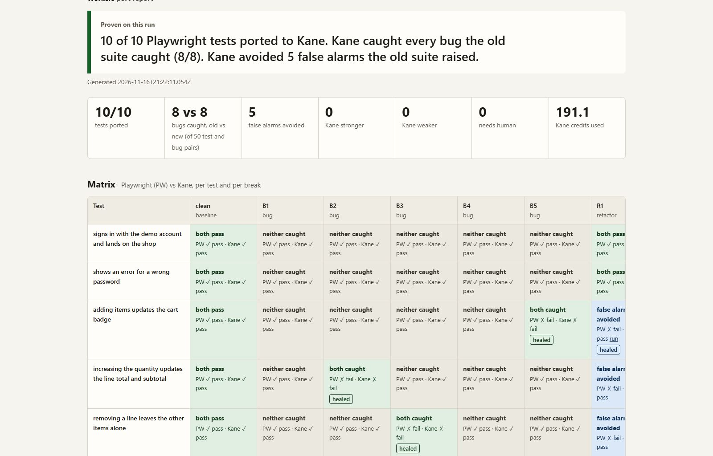

# Workers

[](https://github.com/Techkeyy/workers/actions/workflows/ci.yml)

Workers ports your Playwright suite to Kane CLI tests and proves the new tests catch the same bugs, by breaking your app on purpose. When a ported test is weaker, your coding agent rewrites it from Kane's own result.

**[Live site](https://workers-port.vercel.app)** · **[Report: TodoMVC](https://workers-port.vercel.app/report/)** · **[Report: shop app](https://workers-port.vercel.app/shop-report/)** · **[Report: tighten](https://workers-port.vercel.app/tighten-report/)** · **[Report: bulletproof-react](https://workers-port.vercel.app/oss-report/)** · **[npm: workers-port](https://www.npmjs.com/package/workers-port)** · [Source](https://github.com/Techkeyy/workers)

**[Watch the 3-minute film](https://youtu.be/Ch378w02KHE)**

[](https://youtu.be/Ch378w02KHE)

Teams want off brittle selector tests. Rewriting a suite by hand takes weeks, and nobody trusts an AI rewrite they cannot check. TestMu's own [*State of AI in Quality Engineering 2026*](https://www.testmuai.com/research/state-of-ai-in-quality-engineering.md) puts the median trust in AI-generated tests at 54 out of 100, and finds teams spend 50% of their AI testing budget on generating tests but only 17% on verifying them.

> *"The agent says the new tests are equivalent. Would they actually catch the bug the old ones caught?"*

Workers answers that question with a run, not with the agent's word. Every ported test is checked against deliberate breaks of your app (mutants), side by side with the original Playwright test. **A ported test is only accepted if it catches the same bugs.** On real runs Kane did better than that: across three apps it avoided **8 false alarms** the selector tests raised, and with `--tighten` it **caught 2 bugs the original Playwright test missed** ([below](#tighten-mode-where-kane-beats-the-old-suite)).

Built for the Kane CLI hackathon.



## For judges: the 60-second tour

| Criterion | Where to see it |
|---|---|
| **Bar 1: works end to end** | Real runs on three apps, published as reports: [TodoMVC](https://workers-port.vercel.app/report/) (6 tests, 7 mutants) and a second app, [shop](https://workers-port.vercel.app/shop-report/) (10 tests, 7 mutants), plus a real open-source app, [bulletproof-react](https://workers-port.vercel.app/oss-report/), on its maintainers' own Playwright test. Each ran the full path: list, translate with a coding agent, Playwright on every mutant, Kane on every mutant, parity diff, repair, report. See the [Quickstart](#quickstart). |
| **Bar 2: Kane caught or proved something** | Kane failed on the same planted bugs Playwright failed on: 7 of 7 test and bug pairs in TodoMVC, 8 of 8 in the shop ([how to read these](#results-run-2-on-the-bundled-todomvc-demo)). It also passed 2 and 5 harmless refactors that broke the Playwright selectors. With `--tighten`, Kane **caught 2 bugs Playwright missed** (B2 "1 items left", B3 "2 item left"): [tighten report](https://workers-port.vercel.app/tighten-report/). Screenshots: [`report-matrix.jpg`](docs/images/report-matrix.jpg), [`shop-report.jpg`](docs/images/shop-report.jpg). |
| **Bar 3: agent and Kane talk to each other** | The [repair loop](#the-repair-loop-kane-talks-back-to-the-agent): Kane's result on a mutant goes into the agent's prompt, the agent rewrites the test, Kane runs it again. Screenshot: [`repair-loop.jpg`](docs/images/repair-loop.jpg). Live: the Repair loop section of the [TodoMVC report](https://workers-port.vercel.app/report/). |
| **Ships** | On npm as [`workers-port`](https://www.npmjs.com/package/workers-port), a live [site](https://workers-port.vercel.app) with a [break-it demo](https://workers-port.vercel.app/#break-it), a Claude Code [skill](skill/workers/SKILL.md), 89 unit tests plus both Playwright suites run on every push by [public CI](https://github.com/Techkeyy/workers/actions/workflows/ci.yml). |
| **Verified** | The check is the product: a bug mutant counts as caught only when Playwright and Kane both fail it, from exit codes and JSON. A bug that slipped past both suites in faithful mode (B2) is reported, not hidden, and `--tighten` then catches it. See [How I tried to break it](#how-i-tried-to-break-it). |
| **Closed loop** | Fired three times, all real, with both agents. In run 2, "append new items" was `kane-weaker` on B3: round 1's rewrite broke on the clean app and was rejected, round 2 caught B3. In a [deliberate attack](#attack-a-deliberately-useless-test), a planted useless test was flagged `kane-weaker` on B1 and B3 and repaired in one round ([report](https://workers-port.vercel.app/attack-report/)), then the same again with Claude Code as the agent ([report](https://workers-port.vercel.app/attack-report-claude/)). |
| **Craft** | `npm install workers-port`, then a [dry run that costs no Kane credits](#quickstart). `--resume` after an interrupted run, `--tighten` to find where the old suite is too loose. Findings filed upstream for the Kane team: [kane-cli#254](https://github.com/LambdaTest/kane-cli/issues/254), [#255](https://github.com/LambdaTest/kane-cli/issues/255), [#148 comment](https://github.com/LambdaTest/kane-cli/issues/148#issuecomment-7133820139). |

Raw data behind every number: [TodoMVC `report.json`](https://workers-port.vercel.app/report/report.json) and [shop `report.json`](https://workers-port.vercel.app/shop-report/report.json).

## Why this exists

Playwright tests pin to selectors and `data-testid`s. A harmless markup change breaks them, so teams look at Kane CLI, where tests are plain English steps. The move is the hard part:

- A hand rewrite is weeks of work.
- An agent rewrite is fast, but a test that passes on the clean app proves nothing. A test that asserts nothing passes too.
- Kane's own recording can also be weaker than it looks (see [K1](#platform-feedback-for-kane-cli): it rebuilt "N items left" from a bare number).

What is missing is a check on the port itself. Workers supplies it.

```
   old Playwright test           new Kane test
          |                            |
          +---------- same app --------+
                       |
        clean app: both must pass
        bug mutant:  both must FAIL      <- the new test is as strong
        refactor mutant: Playwright fails, Kane passes   <- the false alarm is gone
```

## What it does

1. **Lists** the Playwright tests (Playwright's own `--list` JSON).
2. **Translates** each test with your coding agent into a Kane `_test.md` in plain English, following `src/rules.md`. Every `expect` becomes an explicit "Verify" line. Local files a spec imports (page objects, fixtures) are sent along, two levels deep, capped at 40 KB. The agent returns text; Workers writes the files.
3. **Runs Playwright** on the clean app, then on every mutant. Each mutant is applied to the app, the suite runs, and the mutant is reverted (also on errors and Ctrl+C).
4. **Runs Kane**: authors each test on the clean app, then runs it on every mutant with Kane's default self-healing, the way it runs in CI. The test's local recordings are restored from a clean snapshot before and after every run.
5. **Diffs parity** with plain code, no LLM. Verdicts come from Playwright's JSON and Kane's exit code and `run_end` status.
6. **Repairs** weak tests. For each test Kane is weaker on, the agent gets what the old test asserted and what Kane did, rewrites it, and Workers re-runs it, up to 2 rounds. The agent never sees the mutant. A test still weak after the cap is marked "needs human".
7. **Reports** `report.html` and `report.json`: the matrix, findings, repair log with a real line diff, Kane dashboard links, before and after line counts.

Cell classes:

| Class | Meaning |
|---|---|
| `ok` | passes on the clean app in both suites |
| `broken-on-clean` | the Kane test fails on the clean app, so it needs a repair |
| `parity-caught` | bug mutant: Playwright and Kane both fail it |
| `parity-missed` | bug mutant: neither suite fails it (this test does not check that behaviour) |
| `kane-weaker` | bug mutant: Playwright fails it, Kane passes. Repair round |
| `kane-stronger` | bug mutant: Kane fails it, Playwright passes |
| `parity` | refactor mutant: both pass |
| `false-alarm-avoided` | refactor mutant: Playwright fails, Kane passes |
| `kane-false-alarm` | refactor mutant: Kane fails |

The pitch is plain English and no selectors, not shorter files: in run 2 the six `_test.md` files total 116 lines against 79 for the Playwright originals, and in the shop run 243 against 77.

## Results: run 2 on the bundled TodoMVC demo

Six tests from Playwright's example spec, 7 mutants (5 bugs B1 to B5, 2 refactors R1, R2), Kane with self-healing on, local recordings restored per run. Source: [`report.json`](https://workers-port.vercel.app/report/report.json), rendered at [/report/](https://workers-port.vercel.app/report/).

"Bugs caught" counts test and bug pairs: one test failing on one bug. There are 6 tests times 5 bugs, so 30 pairs. Playwright failed on 7 of them, and Kane failed on the same 7. Across the suite, 4 of the 5 distinct bugs were caught (B1, B3, B4, B5) and B2 by none.

| | 6 tests, 7 mutants |
|---|---|
| Test and bug pairs caught, old suite | 7 of 30 |
| Test and bug pairs caught, new suite | 7 of 30 |
| False alarms avoided | 2 |
| Kane weaker | 0 |
| Needs human | 0 |
| Bugs that slipped past both suites | 1 (B2) |
| Repaired tests | 1 (2 rounds) |
| Kane credits | 389.8 |

Mutants: B1 active count counts completed items, B2 counter always says "items", B3 counter always says "item", B4 "Clear completed" removes active items, B5 Escape saves the edit, R1 counter test-id renamed, R2 extra class on the clear button.

`C` = bug caught by both Playwright and Kane. `.` = both pass (the test does not check that). `A` = refactor, Playwright fails, Kane passes (false alarm avoided). `ok` = both pass on the clean app.

| Test | clean | B1 | B2 | B3 | B4 | B5 | R1 | R2 |
|---|---|---|---|---|---|---|---|---|
| add todo items | ok | . | . | . | . | . | . | . |
| append new items to the bottom (repaired) | ok | C | . | C | . | . | A | . |
| cancel edits on escape | ok | . | . | . | . | C | . | . |
| display the current number of todo items | ok | C | . | . | . | . | A | . |
| remove completed items when clicked | ok | . | . | . | C | . | . | . |
| hidden when there are no completed items | ok | C | . | . | C | . | . | . |



The live site replays these recorded results. Pick a bug and it shows what each suite said. Nothing on that page runs live.

### The repair loop: Kane talks back to the agent

"should append new items to the bottom of the list" asserts `toHaveText('3 items left')`.

- **First translation:** `kane-weaker` on B3 (the counter shows "3 item left"). Playwright caught it, Kane did not. In an earlier run the same test caught B3 first time, so Kane's authoring is not deterministic. That is why the port has to be verified.
- **Round 1:** the agent was given what the old test asserted and Kane's step results, and rewrote the test. The rewrite broke on the clean app (`broken-on-clean`) and was rejected. The agent's word was not trusted, the run was.
- **Round 2:** the agent fixed it, using the wording "exact visible text of the todo counter ... is '3 items left'". Kane re-authored it, caught B3, and every other cell held. Final status `repaired`.



### Attack: a deliberately useless test

The obvious way to cheat a port is a test that asserts nothing. It passes on the clean app, so a tool that only checks "green" accepts it. So I planted one: I replaced the translation of "should append new items to the bottom of the list" with a test that does the real setup (adds the three todos) but only checks `Verify the todo list is visible.`. Then I let Workers pick it up with `--resume` and ran it for real against Kane.

| Step | What happened |
| --- | --- |
| Clean app | The useless test passed, as a useless test would. |
| Mutants | It missed B1 and B3, the two bugs the original Playwright test catches. Workers marked it `kane-weaker` on both. |
| Repair round 1 | The agent got the original test's assertions and Kane's step results, never the mutants, and rewrote the test with three real checks: the exact counter text `"3 items left"`, the exact list order, and the same list after a reload. |
| Re-run | Kane re-authored the rewrite and **caught B1 and B3**. Every other cell held, including the R1 false alarm avoided. Final status `repaired`, 71.4 credits. |

Report: [attack-report](https://workers-port.vercel.app/attack-report/) · [raw `report.json`](https://workers-port.vercel.app/attack-report/report.json)

**Same attack, with Claude Code as the agent.** I repeated it with `--agent claude`. The result was the same: the useless test was flagged `kane-weaker` on B1 and B3, and Claude rewrote it in one round with the exact counter text and the exact list order. Kane then caught both bugs, for 60.3 credits. Report: [attack-report-claude](https://workers-port.vercel.app/attack-report-claude/) · [raw `report.json`](https://workers-port.vercel.app/attack-report-claude/report.json)

## Results: a real open-source app (bulletproof-react)

To answer "what happens on a real one?" with something I did not write, I ran Workers on [alan2207/bulletproof-react](https://github.com/alan2207/bulletproof-react) (`apps/react-vite`, commit `9506629`), a widely used reference app whose Playwright suite is written by its maintainers. Its tests log in through a Playwright **setup project** (`auth.setup.ts` plus `storageState`), the way real suites do, so the test file itself never shows the login. I used its `profile` test and two mutants, to keep credits low.

| | Playwright (maintainers' test) | Kane (ported by Workers) |
| --- | --- | --- |
| Clean app | passes | passes: signs up, logs in, updates the profile |
| B1: profile update drops the bio | fails (caught) | fails (caught) |
| R1: close button label "Close" becomes "Dismiss", same behaviour | fails (false alarm) | passes (false alarm avoided) |

It took three attempts, and the two failures each exposed a real gap in Workers, now fixed:

1. **Login in a setup project was invisible.** The first translation had no login, Kane hit the login page, and the agent's repair answer was not a valid test. Workers now sends `*.setup.*` files to the agent, and retries an invalid repair answer once.
2. **One step was too long for Kane.** The sign-up form fitted into one step, which ran past Kane's per-step action cap ("Maximum steps exceeded 16/15"). The rules now keep each step to about 8 actions and split long flows.

The third run passed for 102.1 Kane credits (about 173 across all three). Report: [oss-report](https://workers-port.vercel.app/oss-report/) · [raw `report.json`](https://workers-port.vercel.app/oss-report/report.json) · [how to reproduce](examples/bulletproof-react/README.md)

## Tighten mode: where Kane beats the old suite

Workers translates faithfully by default, so a loose Playwright check stays loose. Playwright's own counter test checks the counter with `toContainText('1')` and `toContainText('2')`, so it passes when the counter says "1 items left". That is why B2 slipped past both suites in run 2.

`--tighten` translates loose text checks into the exact visible text a person would read, worked out from the test file itself. On that counter test the agent (Claude Code) wrote `Verify the exact visible text of the todo counter is "1 item left"`. Then a real run against all 7 mutants:

| Mutant | Playwright (unchanged example test) | Kane, tightened |
| --- | --- | --- |
| B1: count shows completed items | fails (caught) | fails (caught) |
| **B2: always "items" ("1 items left")** | **passes (missed)** | **fails (caught)** |
| **B3: always "item" ("2 item left")** | **passes (missed)** | **fails (caught)** |
| R1: test id renamed, same behaviour | fails (false alarm) | passes (false alarm avoided) |

So the result was `kane-stronger` on 2 bugs, with nothing lost and 101.7 credits spent. The mutants are the same ones used since day one, and the Playwright test is Playwright's own unchanged example. The only difference is that the Kane test checks what a user reads.

Report: [tighten-report](https://workers-port.vercel.app/tighten-report/) · [raw `report.json`](https://workers-port.vercel.app/tighten-report/report.json)

## Results: a second app with a real-world suite

TodoMVC's example suite is tidy. Real suites are not. So I ran Workers on a second app, [`examples/shop`](examples/shop) ("Inkwell Supply": login, cart, coupon, checkout), with a Playwright suite written the way teams write them:

- page objects in their own files (`pages/LoginPage.ts`, `ShopPage.ts`, `CartPage.ts`)
- a `loggedInPage` fixture built with `test.extend`
- role-based locators
- three spec files, 10 tests in total

**What this exposed and fixed:** the translator only sent the agent the test block, so imported page objects were invisible to it. It now includes the local files a spec imports. In the translations:

- the fixture became the real login steps with the demo account
- `addToCart('Fountain Pen')` became `Click the button labeled "Add Fountain Pen to cart".`

**The result** (source: [`report.json`](https://workers-port.vercel.app/shop-report/report.json)):

| | |
| --- | --- |
| Tests ported | 10/10 |
| Test and bug pairs caught, old suite / Kane (of 50) | 8 / 8 |
| Distinct bugs caught (B1 to B5) | all 5 |
| False alarms avoided (a renamed `data-testid`, restructured markup) | 5 |
| Kane weaker / needs human | 0 / 0 |



[Read the full shop report](https://workers-port.vercel.app/shop-report/).

This run was interrupted halfway by a machine restart and finished with `--resume`, so the credits figure in that report (191.1) only covers the resumed part.

## Quickstart

Prerequisites:

- Node 22 or newer (`engines` in `package.json`)
- `kane-cli` (`npm install -g @testmuai/kane-cli`), logged in, with credits
- `claude` or `codex` CLI, logged in
- Chromium for Playwright (installed by the command below)

From npm, in any empty folder (the demo app and its Playwright suite are copied to `./workers-demo`):

```bash
npm install workers-port
npx playwright install chromium

# everything except Kane: list, translate, run Playwright on every mutant, print a credit estimate
npx workers-port demo --dry-run --max-tests 1

# the real run (spends Kane credits)
npx workers-port demo --max-tests 3
```

Or from a clone of this repo:

```bash
git clone https://github.com/Techkeyy/workers
cd workers
npm ci
npx playwright install chromium

# everything except Kane: list, translate, run Playwright on every mutant, print a credit estimate
node bin/workers.js demo --dry-run --max-tests 1

# the real run (spends Kane credits)
node bin/workers.js demo --max-tests 3
```

The claude adapter is the default (`--agent claude`, falling back to codex if claude is not logged in and codex is). To use Codex: `--agent codex`. If Codex's configured default model is not available on your account, pass `--agent-model <a model your account supports>`. The TodoMVC and shop runs used `--agent codex --agent-model gpt-5.6-terra`. The second attack run used `--agent claude`.

`--grep "title one|title two"` ports only tests whose title contains one of the strings. Run 2 used it to pick the six tests that cover every mutant. Without `--max-tests` or `--grep`, the demo ports the whole 24-test spec.

If a run is interrupted, `--resume` with the same `--out` folder reuses the `_test.md` files already written, and Kane replays their recordings instead of authoring them again.

Credits, as I measured them: about 40 per authored test, 0 per clean replay, 10 to 30 per mutant run where self-healing kicks in. Run 2 cost 389.8 credits for 6 tests.

## Using it on your own project

```bash
node bin/workers.js port --config playwright.config.ts --app ./my-app --mutants workers.mutants.json
```

Options: `--url`, `--out`, `--grep`, `--max-tests`, `--repair-rounds`, `--agent`, `--agent-model`, `--resume`, `--tighten`, `--dry-run`. Run `node bin/workers.js --help` for the full list. Run `--dry-run` first.

The mutants file is a JSON array. Each mutant edits one file in `--app` with an exact find and replace, temporarily:

```json
[
  {
    "id": "B3",
    "kind": "bug",
    "description": "Counter always says \"item\" (so \"3 item left\")",
    "file": "app.js",
    "find": "const itemWord = activeCount === 1 ? 'item' : 'items';",
    "replace": "const itemWord = 'item';"
  }
]
```

`kind` is `bug` (behaviour changes, both suites should fail) or `refactor` (markup changes, behaviour stays, Playwright may fail and Kane should pass). Bundled files: [`demo/workers.mutants.json`](demo/workers.mutants.json) and [`examples/shop/workers.mutants.json`](examples/shop/workers.mutants.json). Originals are kept in `<file>.workers-backup` and restored when the run ends, fails, is interrupted, or at the next startup.

## Claude Code skill

`skill/workers/` lets you say "port my Playwright tests to Kane" inside Claude Code. Install it by copying the folder:

```bash
mkdir -p ~/.claude/skills
cp -r skill/workers ~/.claude/skills/
```

Use `.claude/skills/` instead for a single project, then start a new Claude Code session. See [`skill/README.md`](skill/README.md).

**Tested.** In a clean folder with only `npm install workers-port` and the skill in `.claude/skills/`, I gave a fresh Claude Code session one line: "Port my Playwright tests to Kane… only 1 test… don't spend any Kane credits yet."

- **Skill loaded on its own:** the session's first action was to load the Workers skill.
- **Followed the workflow:** it checked `kane-cli whoami`, the balance and the agent, then ran `workers demo --dry-run --max-tests 1`.
- **Dry run result:** codex translated the test and Playwright ran it on all 7 mutants, for 0 Kane credits.
- **Stopped before spending:** it showed a credit estimate (about 40) and waited for approval.
- **Caught a weak pick:** it pointed out that the test `--max-tests 1` picked catches none of the bugs, and suggested `--grep` for one that does.

## How I tried to break it

| Attack | Result |
|---|---|
| The agent sees the mutant and tunes the test to it | It cannot. The repair prompt holds the old test's Playwright error and source plus Kane's step results, never the mutant's id, description, file or diff. A unit test pins this. |
| The agent writes a test that asserts nothing | It has to fail the mutants the old test fails. In run 2, round 1's weaker rewrite of the append test did not survive the runs: it broke on the clean app and was rejected. A direct attack with a useless test is [reported above](#attack-a-deliberately-useless-test). |
| Kane heals around a bug and passes it | A heal that passes a bug mutant still counts as a miss (`kane-weaker`). A heal that passes a refactor counts as a false alarm avoided, with the heal flagged. |
| Strict replay hides the brittleness story | In strict replay Kane's recorded checks use `data-testid` selectors like Playwright does (R1 was a `kane-false-alarm` with healing off). So Workers runs Kane the way CI does, with self-healing on, and restores the clean recordings before every run. |
| Kane authoring changes between runs | It does. The same test caught B3 in run 1 and missed it in run 2 before repair. That is the case for verifying every port. |
| A bug neither suite catches | B2 ("1 items left") slipped past both suites in TodoMVC. It is reported as missed, not hidden. |
| Imported page objects are invisible to the agent | They were, in the first version. The shop run exposed it, and the translator now sends the imported files. A unit test pins that the shop spec pulls in its page objects and fixtures. |
| Mutant left in the app after a crash | Reverted on errors and SIGINT, and at next startup. `demo/app` was clean after run 2. |

**A bug-mutant cell is only `parity-caught` when both suites actually failed. Verdicts come from exit codes and JSON, never from the agent.** Rules decide, the agent only writes tests.

The Workers code itself has 89 unit tests (`npm test`, which runs `node --test`), plus the real runs above.

## Architecture

| File | Job |
|---|---|
| `bin/workers.js` | CLI entry: `port` and `demo` |
| `src/port.js` | Orchestrates the full run: translate, baseline, mutants, parity, repair, report |
| `src/inventory.js` | Lists Playwright tests from `--list` JSON |
| `src/translate.js` | Extracts a test's source, collects its local imports, asks the agent, validates the `_test.md` |
| `src/rules.md` | The translation rules the agent follows |
| `src/agents.js` | Adapters for claude and codex |
| `src/run-playwright.js` | Parses Playwright results into per-test verdicts |
| `src/run-kane.js` | Runs Kane and parses its NDJSON into a result |
| `src/kane-cache.js` | Snapshots and restores Kane's per-test recordings |
| `src/mutants.js` | Loads, applies and reverts mutants |
| `src/parity.js` | Pure function: verdicts to cell class |
| `src/loop.js` | Builds the repair prompt (no mutant details) and runs the rounds |
| `src/diff.js` | Line-based LCS diff for the repair log |
| `src/report.js` | Renders `report.html` and `report.json` |
| `src/server.js` | Makes sure the app is being served |
| `src/util.js` | Runs child processes |

## Platform feedback for Kane CLI

I built on `kane-cli` 0.10.4 (`testmd run`, NDJSON `--agent` output, `output-<stem>/` recordings, self-healing). Mutation checks turn up things normal use rarely does. These are observations from my runs, and I filed them upstream: K1 as [kane-cli#254](https://github.com/LambdaTest/kane-cli/issues/254), T1 as [kane-cli#255](https://github.com/LambdaTest/kane-cli/issues/255), and K2 as [a comment on kane-cli#148](https://github.com/LambdaTest/kane-cli/issues/148#issuecomment-7133820139), which already tracks the same symptom from a different trigger.

- **K1, plural label rebuilt in extraction.** The recorded `code_js` for "Verify the counter reads '1 item left'" reads only the number and rebuilds the text: ``const n=Number(strong.textContent); return `${n} item${n===1?'':'s'} left` ``. A replay with `--no-adaptive-heal` on B2 passed, while Playwright's read of the DOM gave "1 items left". So a label or plural bug cannot be caught by that check. Wording like "the exact visible text of X is ..." helps (B3 was caught), and Workers uses it, but the recorded check can still differ between authoring runs.
- **T1, localStorage reads time out.** Authoring a test that verified localStorage failed with "verification setup repeatedly timed out reading browser storage". Workers translates those checks into reload then verify what is visible.
- **K2, a failed healed run replaced the local recordings.** A failed run with healing on set `artifacts.replaced: true` for B1. The next run (B2) had 0 replay decisions and re-authored on the mutant, about 49 credits, committing that version. Restoring `output-<stem>/` from a snapshot fixed it locally (a clean replay after restore cost 0 credits). It would help if a failed run left the recordings alone.

## Limitations

- Mutants are hand-written. Workers does not generate them.
- Both agents are proven with real Kane runs, but on different scales. The two full app runs used codex. Claude Code was run on one test: a dry-run translation, and the attack repair with real Kane runs.
- Kane runs sequentially, about a minute each.
- Desktop web only.
- Tests run against a local app.
- In faithful mode one planted bug (B2) slipped past both suites in the TodoMVC demo. `--tighten` catches it, but tighten mode is only as good as the agent's reading of the expected text.
- Ctrl+C reverts any applied mutant, but a dev server that Workers started itself may keep running; stop it by hand.
- `--resume` reuses existing `_test.md` files as they are. If you edit a Playwright spec between runs, delete its folder in `--out` first.

## License

MIT, see [LICENSE](LICENSE). `demo/tests/demo-todo-app.spec.ts` is Playwright's example spec from the `create-playwright` package (version 1.17.130, Microsoft, MIT). Only its URL was changed, see [`demo/tests/NOTICE.md`](demo/tests/NOTICE.md).
